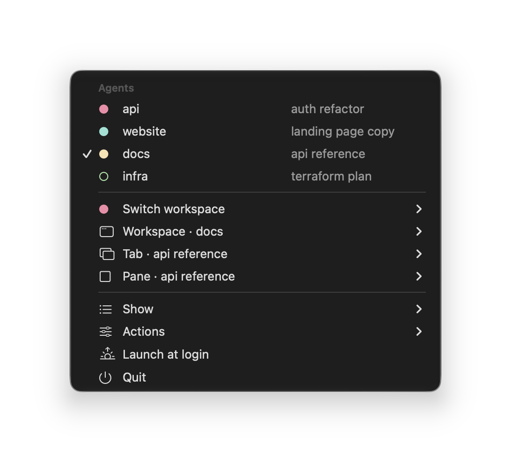
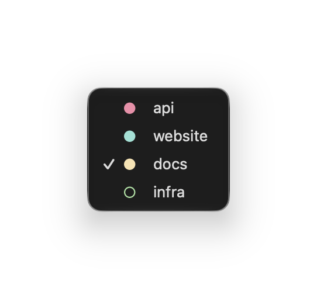
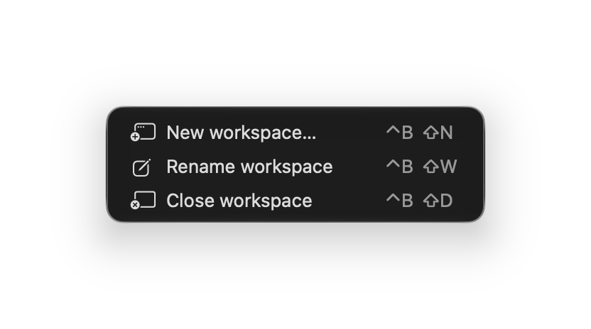
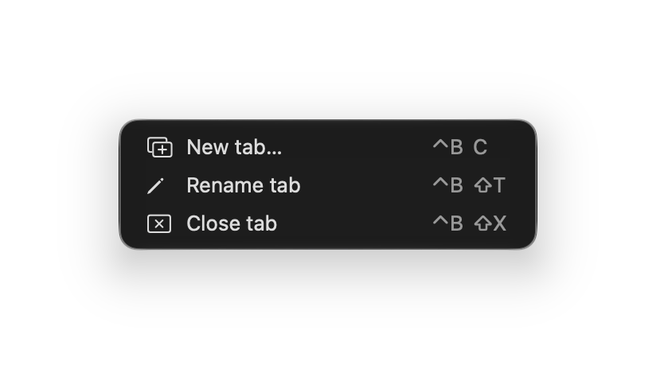
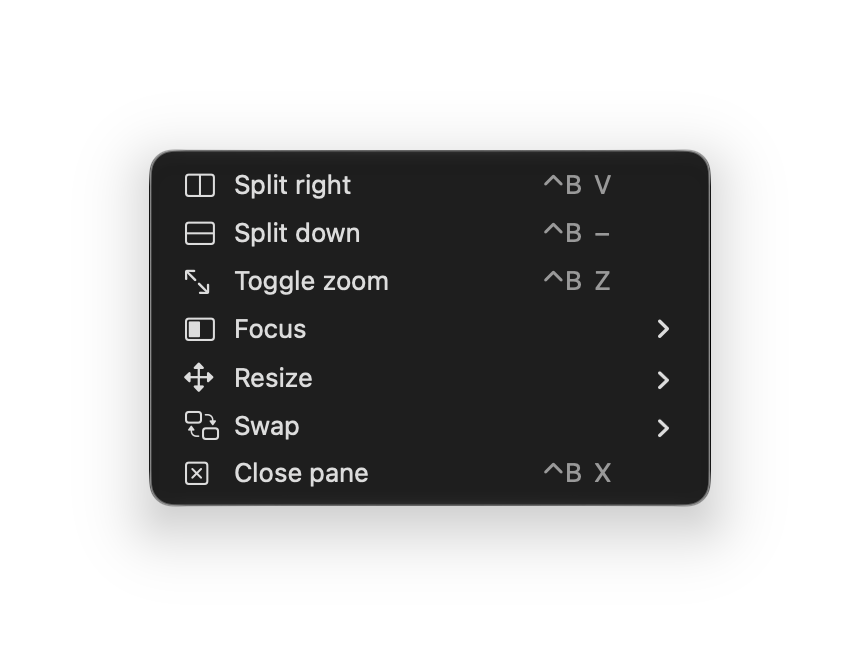
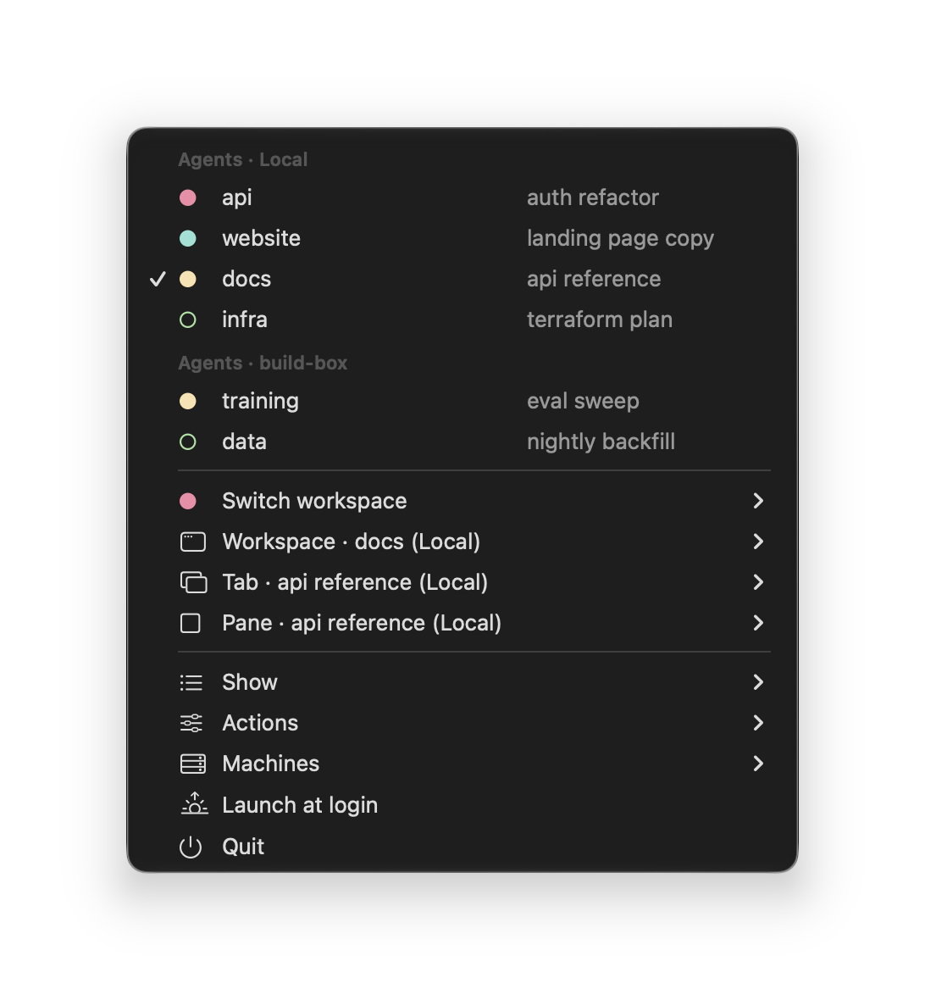
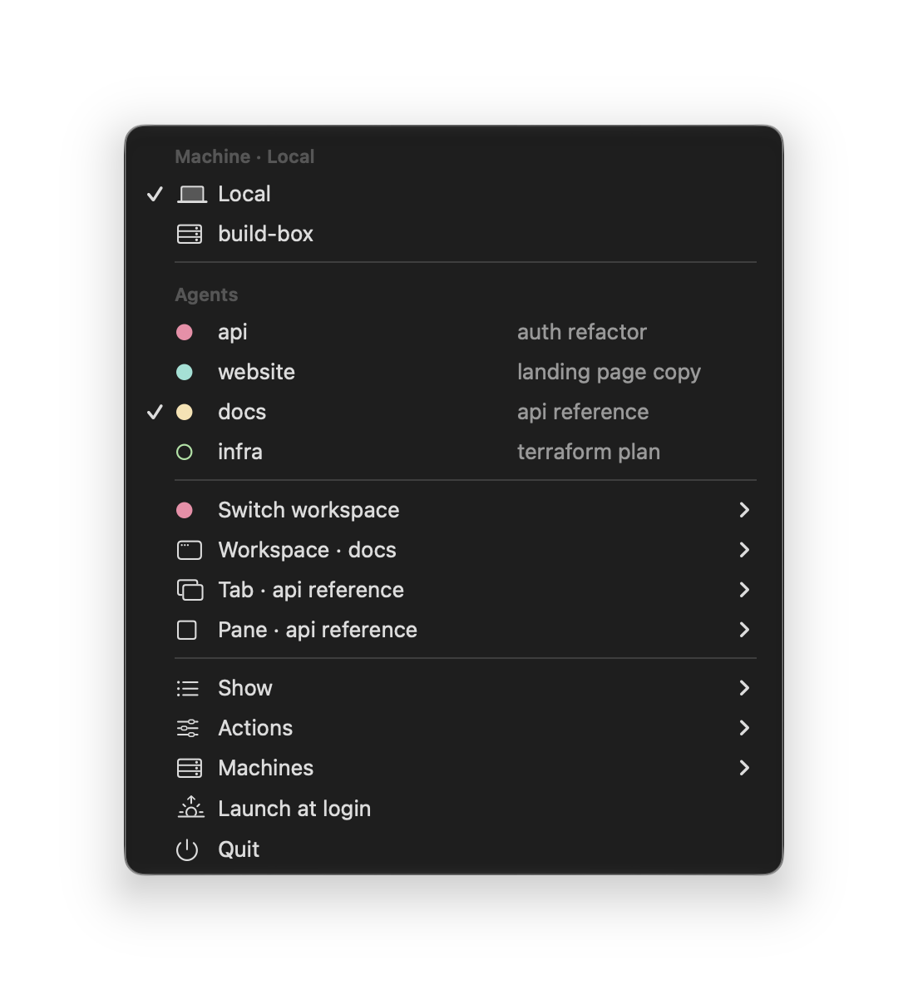
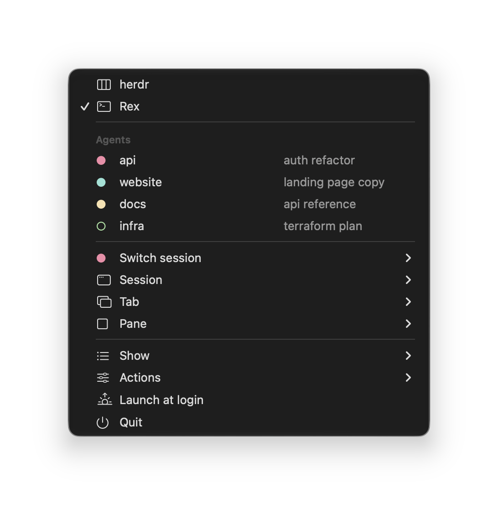
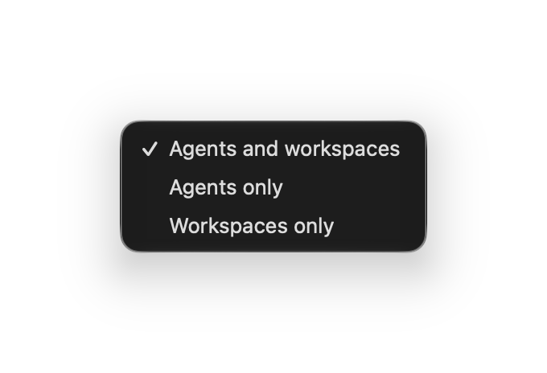

<p align="center">
  
</p>

<h1 align="center">HerdrMenu</h1>

<p align="center">A Rectangle-style macOS menu bar app for <a href="https://herdr.dev">herdr</a>.</p>

<p align="center">
  <a href="LICENSE"></a>
  
  
  <a href="https://herdr.dev"></a>
</p>

<p align="center">
  
</p>

- **Agents** at the top of the menu, with herdr's status dots. Click one to jump to it.
- **A badge on the sheep** when an agent needs you (see [the sheep](#the-sheep) below).
- **One-click actions** for panes (split, zoom, focus, resize, swap, close), tabs and workspaces (new, rename, close), each section in a submenu named after the focused one, plus **Switch workspace** to jump between your workspaces.
  **New tab…** and **New workspace…** ask for a name first; hold **⌥ Option** for the quick versions, which create them straight away like herdr's keybinds.
- **herdr's keybind next to each action,** so the menu doubles as a cheat sheet.

### Submenus

| Switch workspace | Workspace |
|:---:|:---:|
|  |  |
| **Tab** | **Pane** |
|  |  |

It calls the `herdr` CLI rather than faking keystrokes, so it acts on whichever pane you're looking at and doesn't need Accessibility permission. After a click, it brings your terminal to the front. The icon only appears while herdr is open.

### The sheep

| Icon | What it means |
|:---:|---|
|  | herdr is open and no agent needs you |
|  | An agent is blocked, waiting on you (for example, for an approval) |
|  | An agent has finished and you haven't looked at it yet |

Hover over the sheep to see how many agents are blocked or done. Viewing a finished agent in herdr clears its badge.

### Several machines

<p align="center">
  
  
</p>

If you've saved SSH machines with `herdr machine add`, the sheep's badge counts agents on all of them. **Machines** chooses how the menu shows them:

- **All together** (default): each enabled machine's agents under their own heading, and every machine's workspaces. The Workspace, Tab and Pane actions act on the machine the herdr TUI is showing, or Local, named in their headers.
- **One at a time**: a **Machine** section at the top picks one machine, and the rest of the menu shows and acts on just that one.

Everything goes through `herdr --machine <id> ...`, so it needs herdr 0.9.5 or later on both ends. A machine that doesn't answer within 3 seconds shows as *Not reachable*.

Clicking a remote agent moves focus on that machine's server. You only see it if your TUI is showing that machine, because the CLI can't switch the TUI's machine for you.

### Rex

<p align="center">
  
</p>

The menu drives whichever of **herdr** and **[Rex](https://www.superlogical.com/rex)** is open. When both are, a switch at the top of the menu picks one. In Rex mode the menu bar shows Rex's mascot instead of the sheep, and the menu works the same way, in Rex's words:

- **Agents** are terminals whose program reports a status to Rex (OSC 7501, as Claude Code does), with the same dots and badge. Click one to show its session in the Rex app and focus it.
- **Workspaces are sessions**, tabs are tabs (Rex's windows), and panes are panes (Rex's blocks). Swap is **Move**, Rex's name for it.
- **Machines are hosts**: everything in `rex hosts` is listed, through `rex -S <host> ...`.
- The actions run the Rex app's own actions (`rex do pane.split.right` and so on), so they act on whatever has focus in Rex. Renaming uses the app's inline rename, and new tabs and sessions don't ask for a name. Because the Rex server doesn't say which session the app is showing, the section rows don't name the focused one.
- Keybinds shown are the ones in your `init.lua` (`rex keymap`). The app's built-in shortcuts aren't visible to the server, so they don't show.

The icon shows while a herdr client or the Rex app is open. The badge counts the agents of the one the menu drives. It needs the `rex` CLI that comes with Rex.

### Settings

<p align="center">
  
</p>

- **herdr / Rex** at the top, while both are open: which one the menu drives (`defaults write dev.pierre-charles.herdr-menu backend rex`).
- **Show**: agents and workspaces (default), agents only, or workspaces only (listed in the menu itself rather than under **Switch workspace**).
- **Actions**: turn the Workspace, Tab and Pane submenus on or off (all on by default). **Switch workspace** stays either way.
- **Machines** (**Hosts** for Rex): all together or one at a time (only with saved SSH machines or Rex hosts).

These are stored in the app's defaults, e.g. `defaults write dev.pierre-charles.herdr-menu show agents` or `defaults write dev.pierre-charles.herdr-menu actions.pane off`.

## Requirements

- macOS 14 or later
- The Xcode command line tools (`xcode-select --install`), for `swiftc`
- herdr 0.9.1 or later, installed in `~/.local/bin` (herdr's install script), `/opt/homebrew/bin` or `/usr/local/bin`. If you've updated herdr, make sure the running server is the new version too: `herdr status` should show `server_binary_stale: no`.

## Install

```sh
git clone https://github.com/pierre-charles/herdr-menu.git
cd herdr-menu
./build.sh
open ~/Applications/HerdrMenu.app
```

`build.sh` builds and signs the app into `~/Applications`. Then open herdr, click the sheep in the menu bar and tick **Launch at login** so it starts every time you log in. It's listed in System Settings → General → Login Items.

## Update

```sh
git pull
./build.sh
```

`build.sh` restarts the app if it's running, so the new version takes over straight away.

## Uninstall

Untick **Launch at login**, choose **Quit**, then delete `~/Applications/HerdrMenu.app`.

## Notes

- The keybinds shown are your own: the menu reads `~/.config/herdr/config.toml` each time it opens and resolves them the way herdr does (your `prefix` and `[keys]` entries win, and a default that shares a key with one of your bindings, including `[[keys.command]]` keys, is dropped). Bindings must be on one line, e.g. `new_tab = "prefix+t"` or `new_tab = ["prefix+t", "ctrl+alt+t"]`; the first one is shown.
- The screenshots show made-up workspaces and agents, from fake `herdr` and `rex` CLIs fed to a throwaway copy of the app, so no real names reach the repo.
- Status colours are herdr's Catppuccin palette, its default theme.
- The app icon is herdr's logo (`logo.png`), and the menu bar icon is the same logo converted to a template image (`sheep.png`). Rex's mascot isn't in the repo: the app makes it from the image in your installed Rex app.

## Licence

HerdrMenu's code is released under the [MIT License](LICENSE).

HerdrMenu is an unofficial companion app and isn't affiliated with herdr. The sheep logo comes from [herdrdev/herdr](https://github.com/herdrdev/herdr) (`assets/logo.svg`), and `logo.png` and `sheep.png` stay under herdr's [Apache License 2.0](LICENSE-APACHE). It's used as the app icon and converted to a monochrome menu bar icon.
